<div align="center">


<br/>


</div>

---

### ⚡ About Me

```
> whoami
Emery "Rewrite", Computer Science student, IAI-Togo (2nd year, Tronc Commun)
Currently designing an operating system inspired by Linux, TempleOS & GrapheneOS.
Learning by breaking things, then rebuilding them properly.
```

- 🔭 &nbsp;Currently building **Rewrite_OS**, my own operating system - developed and tested in VM (VirtualBox/QEMU)
- 🌱 &nbsp;Currently deepening **networking, Cisco CCNA, and cybersecurity fundamentals, Wireshark, Docker**
- 👯 &nbsp;I'm looking to collaborate on **beginner-friendly coding projects and open-source tools**
- 🎯 &nbsp;Goal: **become a systems/cybersecurity engineer**, master low-level development
- 🤔 &nbsp;I'm looking for help with **OS development , low-level systems concepts, and Cybersecurity** 
- 💬 &nbsp;Ask me about **OS development, Linux, databases, or how to start from zero**
- 😄 &nbsp;Pronouns: **he/him** 
- ⚡ &nbsp;Fun fact: **I'm building my own OS before I've even finished my CS degree.**

<br/>

### 🛠️ Tech Stack

<p align="left">
  
  
  
  
  
  
  
  
  
  
  
  
  
</p>

<br/>

### 🧩 Featured Project

<!-- ===== FEATURED PROJECT ===== -->

<h2 align="center">🖥️ Featured Project</h2>

<div align="center">

<h3>Rewrite_OS</h3>

<p>
  <strong>A learning-driven operating system project.</strong>
</p>

<p>
  Exploring operating system architecture, low-level programming,
  memory management, and the interaction between software and hardware.
</p>

<a href="https://github.com/Rabb-hemery/Rabb-hemery">
  
</a>

<br/><br/>


</div>

## ⚡ Rewrite_OS — Boot Sequence

<p align="center">
  
</p>

<p align="center">
  <i>Learn. Build. Break. Rebuild.</i>
</p>


### 📊 GitHub Stats


<!-- CONTRIBUTION SNAKE -->

<div align="center">

<h3>🐍 Contribution Graph</h3>

<picture>
  <source
    media="(prefers-color-scheme: dark)"
    srcset="https://raw.githubusercontent.com/Rabb-hemery/Rabb-hemery/output/snake-dark.svg"
  />
  <source
    media="(prefers-color-scheme: light)"
    srcset="https://raw.githubusercontent.com/Rabb-hemery/Rabb-hemery/output/snake-light.svg"
  />
  
</picture>

</div>


<!-- ===== GITHUB STATISTICS ===== -->

<div align="center">

<table>
  <tr>
    <td valign="top">
      <a href="https://github.com/Rabb-hemery">
        
      </a>
    </td>
    <td valign="top">
      <a href="https://github.com/Rabb-hemery">
        
      </a>
    </td>
  </tr>
  <tr>
    <td colspan="2" align="center">
      <a href="https://github.com/Rabb-hemery">
        
      </a>
    </td>
  </tr>
</table>

</div>


### 🔗 Connect

<p align="left">
  <a href="https://www.linkedin.com/in/heeyes-rewrite/"></a>
  <a href="https://x.com/Rewrite_X_"></a>
  <a href="https://www.instagram.com/hemery_code"></a>
  <a href="https://dev.to/rabbhemery"></a>
  <a href="mailto:hemeryfb@gmail.com"></a>
</p>

<br/>

### 💭 Dev Quote

<p align="center">
  
</p>
<br/>
<div align="center">

<i>⭐️ From <a href="https://github.com/Rabb-hemery">Rabb-hemery</a> — building the future, one commit at a time.</i>
</div>
